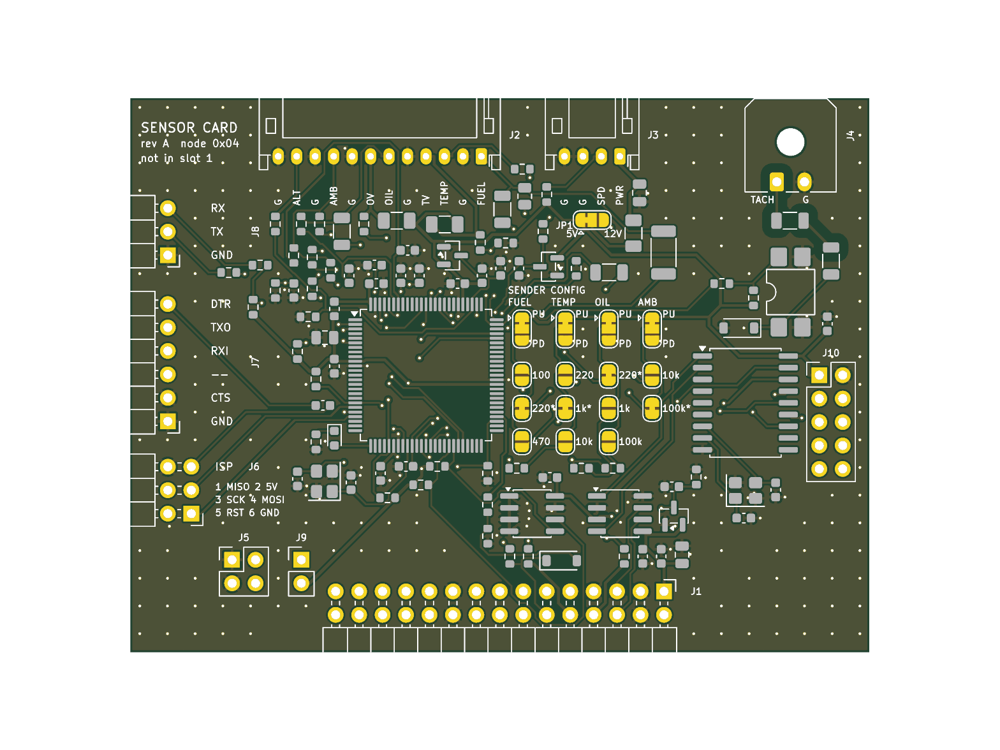
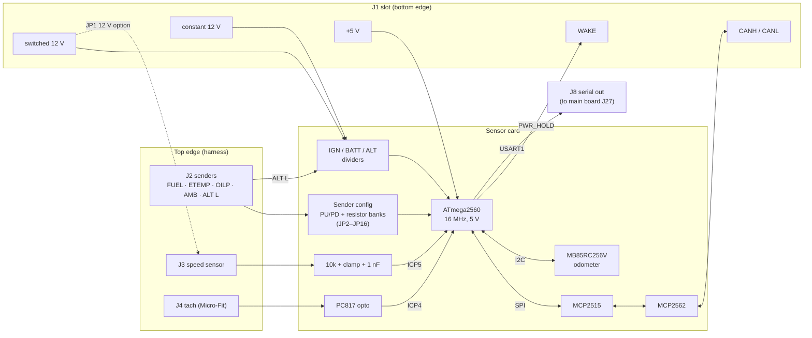
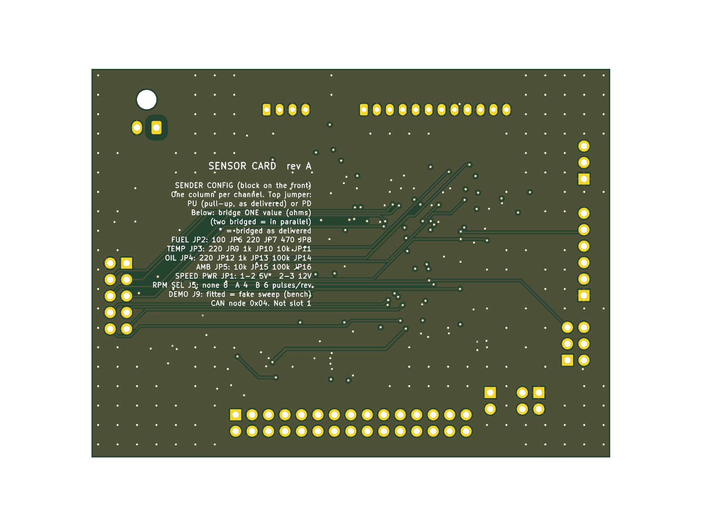
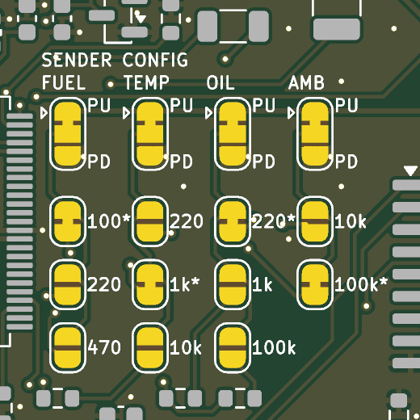

# DigiDash Sensor Card — Datasheet

**Rev A · ATmega2560 sensor pack on a DigiDash rev 2 slot card · CAN node `0x04`**

> **Status: design, not yet built.** Every figure below is calculated from the schematic and the parts' datasheets,
> not measured on a board. Values that depend on the senders in the car are marked as such. The card's firmware (a
> port of `arduino/sketches/sensor_pack`) is not written yet; the firmware interface section describes what the
> hardware provides and what the firmware is planned to send.

---

## 1. Overview

The sensor card reads the car's analog senders, speed and tach, ignition, battery and alternator, keeps the odometer,
and sends the gauge data to the three round screens on the CAN bus. It plugs into any slot of the DigiDash rev 2 main
board except slot 1 and takes all of its power from the slot.

The sender inputs are **configurable on the card**: each channel can be set for a sender grounded through the engine
or tank (pull-up), or a sender fed from the card (pull-down), and its bias resistor can be chosen from a bank of
values, all with solder jumpers. That lets one card read most common resistive gauge senders without changing parts.

### Features

- **ATmega2560-16AU** at 16 MHz, 5 V; 10-bit ADC, ratiometric to the senders' 5 V supply
- **CAN 2.0B** at 500 kbit/s: MCP2515 controller (own 16 MHz crystal) + MCP2562 transceiver; fixed node `0x04`, never
  terminates the bus
- **4 configurable sender channels** (fuel, engine temperature, oil pressure, ambient temperature): pull-up or
  pull-down by solder jumper, a 2- or 3-value resistor bank per channel (values can be combined in parallel), 1 kΩ +
  10 nF input filter
- **Speed input** for hall / square-wave sensors: open-collector or push-pull up to 30 V, sensor supply 5 V or 12 V by
  solder jumper (0.1 A PTC)
- **Tach input**, optically isolated (PC817), for a coil negative terminal (points or HEI) or an ignition box's tach
  output, on its own high-voltage-capable connector
- **Ignition sense** and **battery voltage** from the slot (no harness wires), **alternator "L"** input
- **FRAM odometer** (MB85RC256V, 32 KB, two CRC-protected slots), kept on the card
- **Holds the dash's 5 V rail after key-off** through the slot's WAKE line, to finish its shutdown work
- **Serial frame output** (USART1, 5 V) for an optional jumper wire to the main board's J27, the gauges' fallback path
- ISP and FTDI headers on the edge, reachable with the card in its slot; demo-mode and RPM-select jumpers; 8 spare I/O
- 80 × 60 mm, 4 layers, every part on one side

### Block diagram

---

## 2. Absolute maximum ratings

Design limits, derived from the parts' ratings and the input networks. Beyond them, damage is possible. Not tested.

| Parameter | Min | Max | Unit | Notes |
| --- | --- | --- | --- | --- |
| +5 V supply (slot pins 1, 2) | −0.3 | 6.0 | V | Limited by the ATmega2560 and the FRAM |
| Switched / constant 12 V (slot pins 8, 10) | −0.3 | 16, transients to the main board's TVS clamp | V | The main board's SMCJ33A clamps load dump; the dividers' 15k / 100k tops limit the clamp current to a few mA |
| Sender pins (J2: FUEL, ETEMP, OILP, AMB) | −0.5 | 5.5 | V | **Not protected against a short to 12 V**: the 1 kΩ ADC series resistor and the bank resistor would feed it into the 5 V rail |
| Alternator L (J2 pin 11) | −20 | 40 | V | 22k / 10k divider, BAT54S clamp |
| Speed signal (J3 pin 2) | −20 | 30 | V | 10k series, BAT54S clamp (2.5 mA at 30 V) |
| Tach (J4 pin 1), continuous | −60 | 60 | V | Two 4.7k 1206 in series (0.38 W at 60 V); 1N4148W clamps the reverse |
| Tach (J4 pin 1), pulse | | ±400 | V | Coil kickback: 200 V working voltage per 1206 resistor, about 42 mA peak into the LED (PC817: 1 A pulse) |
| Current out of ETEMP V, OILP V, speed sensor power | | 0.1 | A | 0.1 A hold PTC each (trips at about 0.2 A) |
| Storage temperature | −40 | 100 | °C | |

## 3. Recommended operating conditions

| Parameter | Min | Typ | Max | Unit | Notes |
| --- | --- | --- | --- | --- | --- |
| +5 V supply | 4.75 | 5.0 | 5.25 | V | From the main board's buck, 0.5 A PTC per slot |
| Vehicle system voltage (slot 12 V) | 9 | 13.8 | 16 | V | |
| Operating temperature | −30 | | 85 | °C | Limited by the PC817 (−30 °C) and the ATmega2560 / MCP2515 / FRAM (85 °C) |
| Slot | 2 | | 6 | | Not slot 1 (kept for the audio card) |

## 4. Electrical characteristics

Calculated at +5 V = 5.0 V, 25 °C, unless noted.

### Supply

| Parameter | Typ | Max | Unit | Notes |
| --- | --- | --- | --- | --- |
| +5 V current, card only | 45 | 110 | mA | MCU about 20 mA, MCP2515 5 mA, MCP2562 5 mA recessive / 70 mA dominant (max is a bus held dominant), FRAM, LED, fuse monitors |
| + senders, as delivered | 20 | 50 | mA | Fuel 220 Ω (16–23 mA with a 0–90 Ω sender), oil 220 Ω (12–22 mA), temp 1 kΩ (about 5 mA), ambient (< 0.1 mA) |
| + speed sensor | | 100 | mA | The sensor's own draw, from 5 V or switched 12 V (JP1) |
| Constant 12 V draw, key off | 0.11 | | mA | The battery-sense divider (122 kΩ). The rest of the card is unpowered with the key off |

### Sender channels (J2)

| Parameter | Value | Notes |
| --- | --- | --- |
| ADC | 10 bit, AVCC (5 V) reference, 1 LSB = 4.9 mV | Ratiometric: the bias resistors run from the same 5 V, so supply drift cancels |
| Input filter | 1 kΩ series + 10 nF, τ = 10 µs | Per channel, at the ADC pin |
| Topology | Pull-up (to +5 V) or pull-down (to GND), per channel | Topology jumpers JP2–JP5 |
| Bias resistor | Selected from the bank; ±1 % | See section 6 |
| ETEMP V / OILP V feed | 5 V through a 0.1 A PTC, monitored (TEMP_MON / PRESS_MON) | For senders fed from the card |
| Pull-up power, shorted sender | 0.25 W (100 Ω, 2010), 0.11 W (220 Ω, 1206), 0.05 W (470 Ω, 0805) | Each bank resistor is sized for its value's worst case |

**Reading a sender.** In pull-up mode (sender from the pin to ground), ADC = 1023 × Rs / (Rs + Rb).
In pull-down mode (sender from the V pin to the pin), ADC = 1023 × Rb / (Rs + Rb).
Rs is the sender, Rb the bridged bank value (or the parallel value of several).

### Digital and level inputs

| Input | Network | Switches high above | Switches low below | Filter |
| --- | --- | --- | --- | --- |
| Ignition (slot pin 8 → PA1) | 15k / 10k, BAT54S | 7.5 V | 3.75 V | 100 nF (6 kΩ source: 0.6 ms) |
| Alternator L (J2 pin 11 → PA0) | 22k / 10k, BAT54S | 9.6 V | 4.8 V | 100 nF |
| Speed (J3 pin 2 → ICP5) | 10k pull-up to 5 V, 10k series, BAT54S, 1 nF | 3.0 V (at the pin) | 1.5 V | 10 µs |
| Tach (J4 pin 1 → opto → ICP4) | 2 × 4.7k, PC817, 22k pull-up, 1k, 1 nF | LED on (input high) pulls ICP4 low | | 1 nF + the opto's own speed |

Thresholds use the ATmega2560's guaranteed VIH = 0.6 VCC and VIL = 0.3 VCC; between them the
input's Schmitt trigger gives hysteresis.

| Speed / tach detail | Value |
| --- | --- |
| Speed sensor sink current (open collector) | 0.5 mA |
| Speed clamp current, 12 V / 20 V push-pull output | 0.67 / 1.47 mA |
| Tach LED current at 8 / 12 / 14 / 16 V | 0.72 / 1.15 / 1.36 / 1.57 mA |
| Tach output pull-up current needed | 0.21 mA (switches with a PC817 transfer ratio down to about 20 %) |

### Analog measurements

| Parameter | Value |
| --- | --- |
| Battery (constant 12 V → ADC8) | 100k / 22k: k = 0.1803, full scale 27.7 V, 1 LSB = 27.1 mV, 100 nF filter (1.8 ms) |
| Fuse monitors (ETEMP V, OILP V → PA3, PA4) | 1k / 10k from the feed: high = feed present |

### Communication

| Interface | Detail |
| --- | --- |
| CAN | ISO 11898-2, MCP2562 (VDD = VIO = 5 V, STBY low), 500 kbit/s, no termination on the card |
| Serial out (J8) | USART1, 5 V CMOS, 100 Ω series, 115200 8N1, the 36-byte sensor frame (`docs/protocols/sensor_uart.md`) |
| Debug (J7) | USART0, 5 V, FTDI pinout, DTR auto-reset |
| FRAM | I²C at 0x50, 4.7k pull-ups; 32 KB, 10¹² write cycles |

### Power hold (WAKE)

| Parameter | Value |
| --- | --- |
| WAKE drive | PWR_HOLD (PC1, 5 V) → 4.7k / 10k (3.4 V, 3.2 kΩ source) → BAT42W → slot pin 12: about 3.1 V |
| Effect | Keeps the main board's 5 V buck enabled after key-off (slot WAKE → diode → 47k → buck EN) |
| WAKE sense | Slot pin 12 → 47k → ADC9 / PCINT17: shows another card woke the dash |

---

## 5. Connectors and pin functions

### J1 — slot (right-angle 2×15, bottom edge)

| Pin | Signal | Pin | Signal |
| --- | --- | --- | --- |
| 1 | +5 V | 2 | +5 V |
| 3 | GND | 4 | GND |
| 5 | CANH | 6 | CANL |
| 7 | GND | 8 | Switched 12 V (ignition sense, speed sensor 12 V option) |
| 9 | (3.3 V, not used) | 10 | Constant 12 V (battery sense) |
| 11 | (slot ID, not used: fixed node) | 12 | WAKE |
| 13–18, 21–30 | not used | 19, 20 | GND |

### J2 — senders (JST PH 12, S12B-PH-K, side entry, top edge)

| Pin | Name | Function |
| --- | --- | --- |
| 1 | FUEL | Fuel sender |
| 2 | G | Fuel sender return (to its ground terminal or the tank strap) |
| 3 | TEMP | Engine temperature sender |
| 4 | TV | ETEMP V: 5 V feed (0.1 A PTC) for a 2-wire / 3-wire sender |
| 5 | G | Engine temperature return |
| 6 | OIL | Oil pressure sender |
| 7 | OV | OILP V: 5 V feed (0.1 A PTC) for a 2-wire / 3-wire sender |
| 8 | G | Oil pressure return |
| 9 | AMB | Ambient temperature sensor |
| 10 | G | Ambient return |
| 11 | ALT | Alternator "L" (lamp) terminal, 12 V level |
| 12 | G | Ground |

Pad 1 is on the right, seen from the parts side.

### J3 — speed sensor (JST PH 4, S4B-PH-K, side entry)

| Pin | Name | Function |
| --- | --- | --- |
| 1 | PWR | Sensor power: 5 V or switched 12 V (JP1), 0.1 A PTC |
| 2 | SPD | Signal |
| 3 | G | Ground |
| 4 | G | Ground / cable shield |

### J4 — tach (Molex Micro-Fit 3.0, 43650-0200)

| Pin | Name | Function |
| --- | --- | --- |
| 1 | TACH | Coil negative, HEI "TACH" terminal, or an ignition box's tach output |
| 2 | G | Ground |

The tach nets keep 1.0 mm clearance to everything else up to the two series resistors.

### Left-edge headers (right angle, pin 1 is the lowest pin)

| Ref | Function | Pins |
| --- | --- | --- |
| J8 | Sensor serial out | 1 GND, 2 TX (frames out), 3 RX (in, unused in the car) |
| J7 | FTDI (USART0, 5 V) | 1 GND, 2 CTS (grounded), 3 not connected, 4 RXI, 5 TXO, 6 DTR |
| J6 | AVR ISP | 1 MISO, 2 5V, 3 SCK, 4 MOSI, 5 RST, 6 GND |

### Jumpers and spare I/O (vertical headers)

| Ref | Function | Pins |
| --- | --- | --- |
| J5 | RPM select (pulses per engine revolution) | 1-2 = A, 3-4 = B. None: 8 · A only: 4 · B only: 6 · both: 8 |
| J9 | Demo | Fitted = the card sends a slow fake sweep (bench only). 1 DEMO, 2 +5V |
| J10 | Spare I/O | 1 +5V, 2 GND, 3–6 ADC10–ADC13 (port K: analog, digital or pin-change interrupt), 7–10 D44–D47 (PWM). 5 V logic, unprotected |

---

## 6. Configuration

All settings are solder jumpers on the parts side, in the **SENDER CONFIG** block between the MCU and the CAN
controller, plus JP1 behind the speed connector. The back of the card carries the same table on its silkscreen.

**To change a jumper:** cut the thin trace between the pads of a bridged jumper with a sharp blade (check with a meter
that it is open), and bridge an open jumper with a blob of solder. Change settings with the card out of its slot.

### 6.1 Speed sensor supply — JP1

| JP1 | Sensor power on J3 pin 1 |
| --- | --- |
| **1-2 (as delivered)** | 5 V |
| 2-3 | Slot switched 12 V |

### 6.2 Sender channels — JP2–JP16

Each channel has a **topology jumper** (3 pads, top of its column) and a **bank** of value jumpers below it. The
topology jumper connects the bank's common side to +5 V (PU, pull-up) or to GND (PD, pull-down); each value jumper
connects one resistor between that common side and the channel's input.

| Channel | Topology (PU = 1-2, PD = 2-3) | Bank (value: jumper) | As delivered |
| --- | --- | --- | --- |
| Fuel (ADC0) | JP2 | 100 Ω: JP6 · **220 Ω: JP7** · 470 Ω: JP8 | PU, 220 Ω |
| Engine temp (ADC1) | JP3 | 220 Ω: JP9 · **1 kΩ: JP10** · 10 kΩ: JP11 | PU, 1 kΩ |
| Oil pressure (ADC2) | JP4 | **220 Ω: JP12** · 1 kΩ: JP13 · 100 kΩ: JP14 | PU, 220 Ω |
| Ambient (ADC3) | JP5 | 10 kΩ: JP15 · **100 kΩ: JP16** | PU, 100 kΩ |

- **Bridge exactly one value** per channel for a plain setting. **Two or three bridged** give their parallel value:

  | Bank | Combinations |
  | --- | --- |
  | Fuel | 100‖220 = 69 Ω · 100‖470 = 83 Ω · 220‖470 = 150 Ω · all three = 60 Ω |
  | Temp | 220‖1k = 180 Ω · 220‖10k = 215 Ω · 1k‖10k = 909 Ω |
  | Oil | 220‖1k = 180 Ω · 1k‖100k = 990 Ω |
  | Ambient | 10k‖100k = 9.1 kΩ |

- **No value bridged** leaves the input floating, except through the sender. Use this only for a sender with an
  active output (a 0–5 V transducer) where any bias would load it.
- In **pull-down** mode the bank resistor goes to ground; the sender connects between the channel's V pin (TV / OV,
  5 V through a PTC) and its signal pin. Fuel and ambient have no V pin: their pull-down mode suits a sender with its
  own supply.

### 6.3 Choosing the settings

**Which topology?**

| The sender is… | Topology | Wiring |
| --- | --- | --- |
| A 1-wire gauge sender (grounds through its threads to the block or the tank) | **PU** | Sender terminal → signal pin. Use the channel's return pin for the tank strap / sender ground if there is one |
| A 2-wire resistive sender or thermistor (both terminals insulated) | **PU** | One terminal → signal pin, the other → the channel's return pin (G) |
| A 2-wire sender meant to be fed a voltage | PD | One terminal → V pin (TV / OV), the other → signal pin |
| A 3-wire transducer (5 V, signal, ground; 0.5–4.5 V out) | PD, 100 kΩ (oil) or no value | 5 V → V pin, signal → signal pin, ground → return pin |

**Which value?** In pull-up mode, a bias resistor close to the sender's resistance in the range you care about most
gives the best resolution there (the reading is mid-scale when they are equal). Any value works; the firmware's
calibration table converts the reading.

**Fuel senders, pull-up mode** (ADC counts, empty → full):

| Sender | 100 Ω (JP6) | 220 Ω (JP7, as delivered) | 470 Ω (JP8) | Suggested |
| --- | --- | --- | --- | --- |
| GM to 1964, 0 Ω empty – 30 Ω full | 0 → 236 | 0 → 123 | 0 → 61 | **100 Ω** |
| GM 1965–97, 0 – 90 Ω | 0 → 485 | 0 → 297 | 0 → 164 | 220 Ω (100 Ω for more resolution, at 50 mA) |
| Ford to 1987, 73 – 10 Ω | 432 → 93 | 255 → 44 | 138 → 21 | 100 Ω |
| Aftermarket universal, 240 – 33 Ω | 722 → 254 | 534 → 133 | 346 → 67 | 220 Ω |
| VDO-style, 10 – 180 Ω | 93 → 658 | 44 → 460 | 21 → 283 | 220 Ω |

**Temperature and pressure senders** vary too much between makes to list. Measure the sender at two points (cold and
hot, or zero and running pressure) or take them from its data, and pick the bank value nearest the sender's
resistance at the point you most want to read well. Examples:

| Sender | Setting | ADC counts |
| --- | --- | --- |
| GM 2-wire EFI coolant sensor (about 3.5 kΩ at 20 °C, 180 Ω at 100 °C) | Temp PU, 1 kΩ | about 800 at 20 °C, 155 at 100 °C |
| Same, best resolution when hot | Temp PU, 220 Ω | about 960 at 20 °C, 455 at 100 °C, 300 at 120 °C |
| 10–180 Ω oil pressure sender | Oil PU, 220 Ω | 44 (0) → 460 (full scale) |
| 240–33 Ω oil pressure sender | Oil PU, 220 Ω | 534 (0) → 133 (full scale) |
| 100 kΩ NTC (B3950) ambient | Amb PU, 100 kΩ | 512 at 25 °C |
| 10 kΩ NTC ambient | Amb PU, 10 kΩ (and open JP16) | 512 at 25 °C |

### 6.4 Bench settings

| Setting | How |
| --- | --- |
| Demo sweep | Fit a jumper on J9 |
| RPM select | J5: 1-2 and / or 3-4 (see section 5). A single-coil 4-stroke fires cylinders ÷ 2 times per revolution: a V8 is 4 |

---

## 7. Firmware interface

### MCU pin map (ATmega2560-16AU, TQFP-100)

| Pin | Port | Function | Signal |
| --- | --- | --- | --- |
| 2 / 3 | PE0 / PE1 | RXD0 / TXD0 | J7 FTDI |
| 6 | PE4 | INT4 | MCP2515 INT |
| 19–22 | PB0–PB3 | SS / SCK / MOSI / MISO | MCP2515 (CS pulled up), J6 ISP |
| 26 | PB7 | GPIO (Arduino D13) | Status LED, high = on |
| 30 | RESET | | 10k pull-up, J6, FTDI DTR, MCP2515 RESET |
| 35 | PL0 | ICP4 | Tach (falling edge = spark) |
| 36 | PL1 | ICP5 | Speed |
| 37–40 | PL2–PL5 | D47–D44 | J10 spare |
| 43 / 44 | PD0 / PD1 | SCL / SDA | FRAM |
| 45 / 46 | PD2 / PD3 | RXD1 / TXD1 | J8 serial |
| 53 | PC0 | GPIO in | DEMO (high = demo) |
| 54 | PC1 | GPIO out | PWR_HOLD (high = hold the rail) |
| 71 / 72 | PA7 / PA6 | GPIO in, pull-up | RPM select B / A (low = jumper fitted) |
| 74 / 75 | PA4 / PA3 | GPIO in | Oil / temp feed fuse monitor (high = OK) |
| 77 / 78 | PA1 / PA0 | GPIO in | Ignition / alternator L (high = on / charging) |
| 84–87 | PK5–PK2 | ADC13–ADC10 | J10 spare |
| 88 | PK1 | ADC9 / PCINT17 | WAKE sense |
| 89 | PK0 | ADC8 | Battery: V = ADC × 5 / 1023 × 122 / 22 |
| 94–97 | PF3–PF0 | ADC3–ADC0 | Ambient, oil, temp, fuel |

JTAG (PF4–PF7, ADC4–ADC7) is not used by the card, so the JTAG fuse can stay at its factory setting.

### Fuses and programming

The ATmega2560 arrives blank (internal 1 MHz clock). Program it through J6 with a USBasp, AVRISP mkII or Atmel-ICE
(not a USBtiny: unreliable above 128 KB), with the card powered from its slot:

| Fuse | With an Arduino Mega bootloader | ISP only |
| --- | --- | --- |
| Low | 0xFF (16 MHz crystal) | 0xFF |
| High | 0xD8 (boot reset, 4 KB boot, JTAG off) | 0xD9 |
| Extended | 0xFD (brown-out 2.7 V) | 0xFD |

With the bootloader on, J7 (FTDI) takes uploads like an Arduino Mega.

### CAN (planned, per `docs/hardware/digidash_rev2_plan.md`)

| ID | Rate | Content |
| --- | --- | --- |
| `0x100`–`0x104` | 20 Hz | The sensor frames, same IDs and payloads the center screen sends today (`docs/protocols/can_bus.md`) |
| `0x704` | 1 Hz | Heartbeat, node `0x04`, node type 3 (sensor pack) |

The center stops re-sending `0x100`–`0x104` when it hears them from node `0x04`. The card takes the center's status
(`0x213`) or heartbeat (`0x701`) as its keepalive.

### Conversions the firmware needs

- **Senders:** a per-channel calibration table (raw ADC → value), entered for the senders and settings actually fitted.
  The old 328P firmware's thermistor maths and `*_INVERT_ADC` settings assumed the rev 1 pull-down wiring; with the
  card's pull-up default the reading rises with sender resistance.
- **Battery:** volts = ADC × 0.02710.
- **Speed / tach:** pulse period from input capture; pulses per revolution from J5 (tach) and the speed sensor's
  pulses per mile.
- **Odometer:** stored in the card's FRAM. A new card seeds a blank FRAM with `ODO_INITIAL_TENTHS`; set the car's
  mileage there when replacing a card.

---

## 8. Installation

1. **Configure** the jumpers for the senders in the car (section 6) and program the MCU (section 7).
2. **Plug the card into slot 2–6**, parts side toward slot 1, and plug the harness into J2, J3 and J4 from the top
   edge.
3. **Optional serial fallback:** a 2-wire jumper from J8 pin 2 (TX) and pin 1 (GND) to the main board's J27 pin 1
   (TX IN) and pin 2 (GND). J27 is on the main board's back at the top edge, above slot 4.
4. **Grounds:** for 1-wire senders the engine block and the body are the reference, so the engine-to-body and
   body-to-dash ground straps must be solid. Run the fuel sender's return wire back to J2 pin 2.
5. **Tach wiring:** use the Micro-Fit connector only; keep the tach wire away from the sender and speed wires.

---

## 9. Mechanical

| Parameter | Value |
| --- | --- |
| Board | 80 × 60 mm, 1.6 mm, 4 layers (F signal, In1 GND, In2 signal / GND, B signal / GND) |
| Slot header | Right-angle 2×15, 2.54 mm, centred on the bottom edge, pins 6 mm past the edge; pin 1 is 17.78 mm right of the centre (parts side, top edge up) |
| Top edge | J2 centred at x 27 mm, J3 at x 50 mm, J4 at x 71.5 mm (from the left edge, parts side) |
| Left edge | J8 (pins at y 12–17 mm), J7 (y 22–35 mm), J6 (y 40–45 mm), from the top edge |
| Height, parts side | About 10 mm (J4 and the vertical headers); the slot allows 20 mm |
| Height, back | Solder tails only (under 2.5 mm) |
| Mounting | The slot and the case; no holes |

## 10. Parts

See [`SensorCard_BOM.csv`](SensorCard_BOM.csv). Key parts: ATmega2560-16AU, MCP2515-I/SO, MCP2562-E/SN,
MB85RC256V, PC817 (SMD), two 16 MHz 3225 crystals (CL ≈ 10 pF, 18 pF load caps), JST S12B-PH-K-S and S4B-PH-K-S,
Molex 43650-0200.

## 11. Revision history

| Rev | Date | Change |
| --- | --- | --- |
| A | 2026-10-02 | First release: the sensor pack moved off the DigiDash rev 2 main board onto a slot card, with configurable sender inputs |
