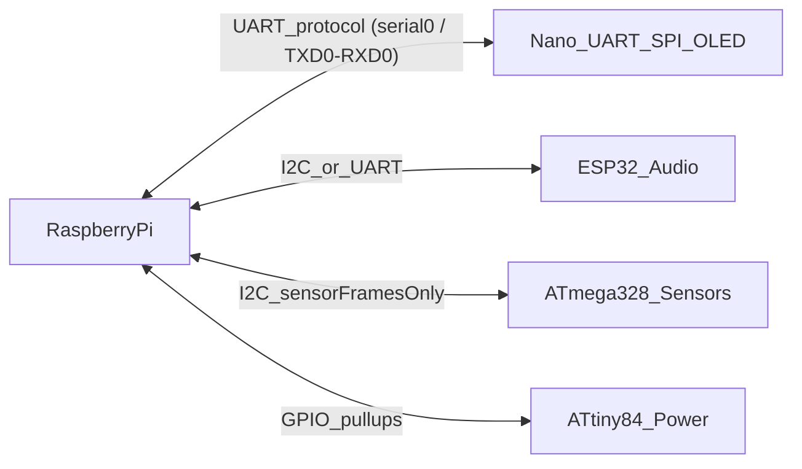

# Round-display and hardware integration overhaul

## Branch and repo artifact

- Create branch (suggested name): `overhaul/round-displays-hardware` (or your naming convention).
- **Save this plan in-repo** as `[docs/OVERHAUL_ROADMAP.md](docs/OVERHAUL_ROADMAP.md)` (or similar) on that branch so it versions with the code and can be revised in PRs. Cursor’s plan UI can mirror the same content initially.

## Principles (non-negotiables)

- **Clean approach:** treat this as a deliberate re-architecture, but **derive structure from existing code** (`DisplayManager`, `DisplayLayout`, theme loader, `menu_schema`, input integrations) rather than rewriting blindly.
- **Pi image generation:** keep the **prebuilt Pi image + hooks** flow as the only ship vehicle (services, `/boot/firmware` logs, single defined startup path). Display and dependency choices must **work on the image** without “deploy phases.”
- **Fast display path:** production intent matches `[scripts/start-gauge-hdmi-kms.sh](scripts/start-gauge-hdmi-kms.sh)` — default `**SDL_VIDEODRIVER=kmsdrm`**, not X11. Any X11-era service wiring is legacy and must be removed in the image hook layer.

## Current baseline (what you are changing)

- **Pygame output paths**: `[src/dashboard/display/manager.py](src/dashboard/display/manager.py)` supports `single_window`, `multi_window`, and `**spi`** (`_init_spi_mode`, `SpiDisplayManager` in `[src/dashboard/spi_display_manager.py](src/dashboard/display/spi_display_manager.py)`). SPI gauge panels are configured via `[config/dashboard.spi.yaml](config/dashboard.spi.yaml)` (`system.spi_displays`).
- **Layout model**: `[src/dashboard/screens/layout.py](src/dashboard/screens/layout.py)` + `[src/dashboard/config.py](src/dashboard/config.py)` allow `shape: round | rectangle`; themes can synthesize virtual panels via `single_screen_displays` / `single_screen_auto_compose` (`[display/manager.py](src/dashboard/display/manager.py)` ~365–446).
- **Rectangle-specific UI**: e.g. corner clock in `[src/dashboard/screens/gauge_screen.py](src/dashboard/screens/gauge_screen.py)` (~215–218) branches on `rectangle`.
- **Boot / placeholder**: `[DisplayManager._render_startup_placeholder](src/dashboard/display/manager.py)` already draws `startup_placeholder_image` until first real frame — keep this contract as the **always-on boot image** until the app loop is healthy.
- **Nano today**: `[arduino/sketches/encoder_controller/encoder_controller.ino](arduino/sketches/encoder_controller/encoder_controller.ino)` emits compact serial frames (`MD=...,AD=...,MP=...,AP=...`); Pi side: `[src/dashboard/input/encoder_arduino_serial.py](src/dashboard/input/encoder_arduino_serial.py)` on **`/dev/serial0`** (primary UART).
- **Sensor pack today**: `[arduino/sketches/sensor_pack/sensor_pack.ino](arduino/sketches/sensor_pack/sensor_pack.ino)` — binary UART packets to Pi.

## Target architecture (agreed geometry)

Per your answer: **three round gauge regions** sized as **1080×1080**, **720×720**, **1080×1080** (diameter = min(width, height) of each region after layout). **Extended desktop vs KMSDRM:** Under **X11/Wayland**, multiple monitors are usually one logical coordinate space — a **single spanning window** is natural. Under **kmsdrm**, behavior is **not guaranteed** to match X11: SDL may expose **one primary output**, **per-output fullscreen**, or other limits depending on Pi OS, DRM mode, and SDL version. **Do not assume spanning works on kmsdrm without measurement.**

**Decision order (KMSDRM-first, no X11 required):**

1. **Spike on target Pi image:** Can pygame/SDL with `kmsdrm` create **one surface** covering the union of the three connectors (or a configured global size)? If **yes**, use **single root surface + YAML viewports** (same as before — ideal).
2. If **no**, prefer **multi_window** / one window per output (existing `[DisplayManager._init_multi_window_mode](src/dashboard/display/manager.py)` path) mapped to each connector — still **no X11**; layout solver targets **per-window rects** but keeps one **logical gauge-pack model** in config.
3. If neither is satisfactory, evaluate a **minimal Wayland compositor** session (still image-gen controlled) before considering X11.

**Single small screen / dev:** unchanged — one canvas (or one window), same pack scaler.

**Optional last resort:** X11 only if hardware/stack forces it; if so, treat as **failure of the kmsdrm plan** and document why — not the default design center.

**Caveat:** if outputs differ in **vertical resolution** (e.g. side monitors 1080px tall, center 720px), the spanning surface height is usually **max** of the row; the shorter output may show **letterboxing/mask** outside the round gauge — encode that in YAML (per-region frame + optional margin) rather than assuming a perfect 2880×1080 rectangle without padding.

### Bus choices (recommendations to lock in early)

| Node          | Role                         | Recommendation                                                                                                                                                           |
| ------------- | ---------------------------- | ------------------------------------------------------------------------------------------------------------------------------------------------------------------------ |
| **ESP32**     | Audio manager                | Prefer **I2C** (or secondary UART) for commands/metadata/volume/transport state; keep heavy audio on ESP (decode/stream), not over I2C payload.                          |
| **Nano**      | Encoders + IR + **SPI OLED** | Keep **UART** to Pi; extend protocol for **downlink display commands** (mode, text lines, animation id). **IR keymap stored on Nano** — Pi receives logical events only. |
| **ATmega328** | Sensor pack                  | **I2C slave only** with fixed sensor-frame register map. Remove UART path and do not include a migration fallback.                                                       |
| **ATtiny84**  | Power / safe shutdown        | **GPIO on Pi** (inputs with pull-ups, open-drain friendly) — dedicated pins for shutdown request, power-good, wake, etc.                                                 |

*(You wrote “esp72”; this plan assumes **ESP32**.)*

## Pygame / display stack

1. **Remove SPI gauge path from Python**
  - Delete or gate `display_render_mode: spi` and `SpiDisplayManager` usage so pygame never talks to gauge SPI.  
  - Hardware SPI for **Nano’s OLED** stays **firmware-only** (not pygame).
2. **Multi-display production model (kmsdrm-validated)**
  - **Goal:** one logical model — **gauge packs + viewports** in YAML — implemented either as **one root surface** (if kmsdrm allows spanning size) or **one window per output** (if that is the kmsdrm-native fit). Reuse existing `single_window` vs `multi_window` machinery in `[display/manager.py](src/dashboard/display/manager.py)`; extend only as the spike dictates.  
  - **Pi image / services:** systemd unit(s) must set `**SDL_VIDEODRIVER=kmsdrm`** (and drop X11 wait loops / `DISPLAY=:0` for production). Remove or replace cursor-hiding services that assume X11 unless still needed for a dev profile.  
  - Rename/repurpose “hdmi” script/service names to neutral **display/cluster** naming when cleaning install paths.
3. **Round-only gauges + theme “packs”**
  - Introduce a theme concept such as `gauge_packs: [{gauge_id, ...}, ...]` (count 1–3 or more) and a **layout solver**: given the **root surface size** (full spanning canvas or single small window), compute each pack’s **diameter** and **center** so packs **scale to fit** (equal or weighted sizing — decide in theme). Viewports for triple-head are just **fixed rects** in config; single-head dev uses the same solver with one rect.  
  - **Deprecate `shape: rectangle`** in config: either remove or treat as alias for “canvas contains only round packs.” Remove rectangle-only drawing branches (e.g. corner clock) or re-express as round-safe HUD elements.  
  - Centralize circle mask application (similar pattern to `[map_screen.py](src/dashboard/screens/map_screen.py)` round mask ~118–121).
4. **Boot screen invariant**
  - Keep **placeholder image** until `DashboardApp` signals “ready” (first healthy frame after integrations init). Optionally add explicit **states**: `boot` → `degraded` → `live` for logging.

## Menu and diagnostics

- **Menu overhaul**: `[config/menu_schema.yaml](config/menu_schema.yaml)` + `[MenuOverlayController](src/dashboard/screens/menu_overlay.py)` — move toward a **versioned schema** (v2), clearer separation of **user-editable settings** (persisted JSON/SQLite — you already have theme/odometer paths) vs **developer YAML**.  
- **Diagnostic mode**: **GPIO pulled to ground** (configurable pin in YAML) enables a **device matrix** page: Nano heartbeat, ESP32 link, 328P last sample age, ATtiny lines, serial port health, I2C probe summary, last errors. Implement via `gpiozero` or `/dev/gpiochip` with minimal coupling.

## Firmware / protocol work (parallel tracks)

- **Nano**: UART framing for **Pi → Nano** (display mode, scroll text, brightness, animation slot) and **Nano → Pi** (encoder deltas, button edges, IR codes → mapped actions). Document in `docs/protocols/nano_uart.md`.  
- **ESP32**: Define command set for playback, source selection, metadata; Pi voice assistant publishes metadata to ESP or Pi displays voice state on gauges only — align with “image gen focused” scope.  
- **328P**: Define an I2C-only sensor-frame register map mirroring current packet fields + fault flags; Pi polls at a fixed rate. Remove UART parsing code and configs.

## Configuration split

- **Developer YAML** (repo): machine layout, bus addresses, pin numbers, boot image path, diagnostic GPIO, enabled integrations.  
- **User settings** (runtime, in-app menus): theme, units, brightness, audio routing preferences, Wi‑Fi, etc. — persist outside repo.

## Phased delivery (suggested)

1. **Branch + roadmap file** in `docs/`.
2. **Display refactor**: spanning-window config + viewport map for 1080/720/1080 regions; remove pygame SPI gauge code path; update only rpi-image-gen layer/hooks for runtime service wiring; smoke tests headless + dev machine (single small window uses same pack scaling).
3. **Gauge pack layout engine** + theme migration for one canonical theme.
4. **Menu v2** skeleton + diagnostic GPIO page stub.
5. **Nano protocol** (bidirectional) + OLED scenes (KITT, menu, metadata, time).
6. **ESP32 + 328P** integration modules on Pi (`ESP32` control link, `328P` I2C-only sensor frames).
7. **ATtiny GPIO** shutdown handshake.

## Risks / open details (iterate in roadmap doc)

- **720 vs 1080 center**: needle/font scaling must be theme-relative (single scale factor derived from pack diameter).  
- **KMSDRM multi-head**: spanning may be unavailable or different from X11; early spike drives architecture — **multi_window per connector** may be the production pattern on Pi without X11.  
- **Image drift**: ensure rpi-image-gen hooks and runtime service definitions match the kmsdrm fast path and contain no X11-era assumptions.  
- **I2C bus load**: sensor rate + ESP commands — consider separate buses or clock stretching.
- **Scope discipline**: no migration/deployment rollout steps; remove `install.sh` and clean legacy rollout/deploy script paths in favor of image hooks only.

